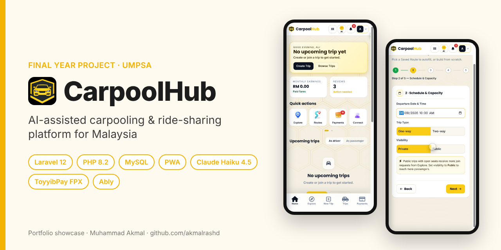
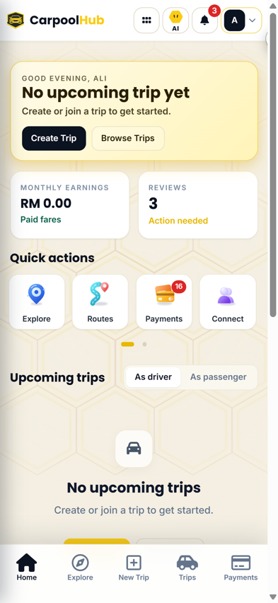
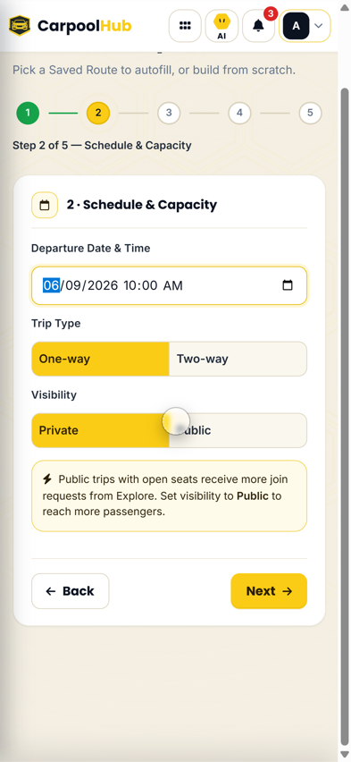
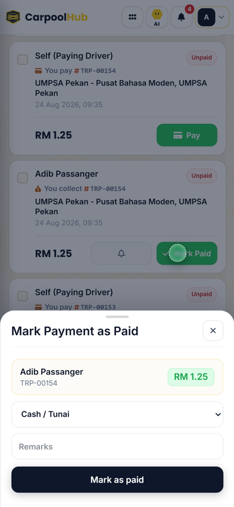
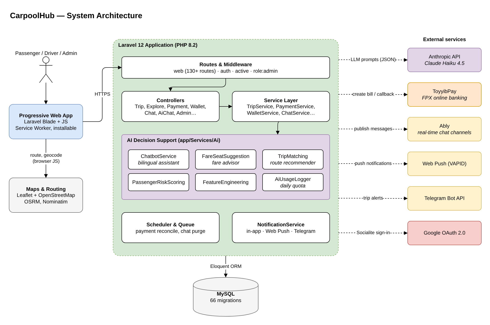
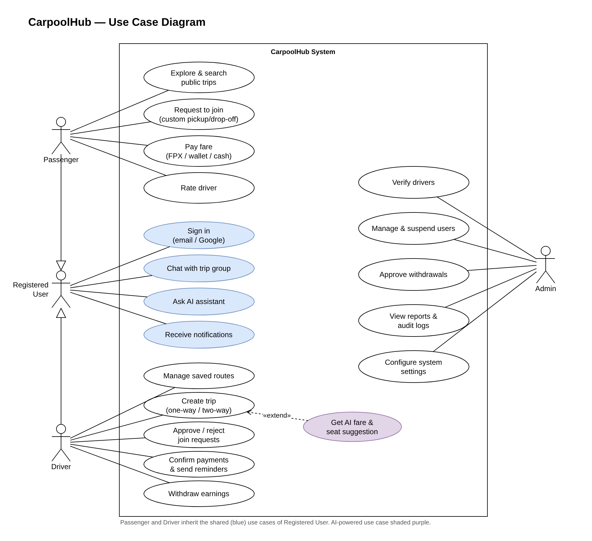
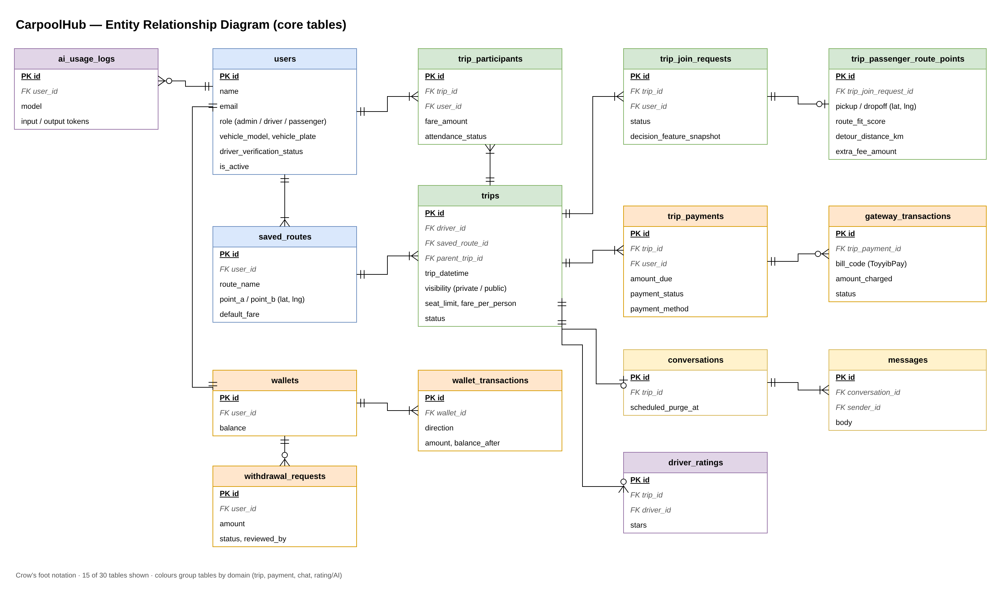
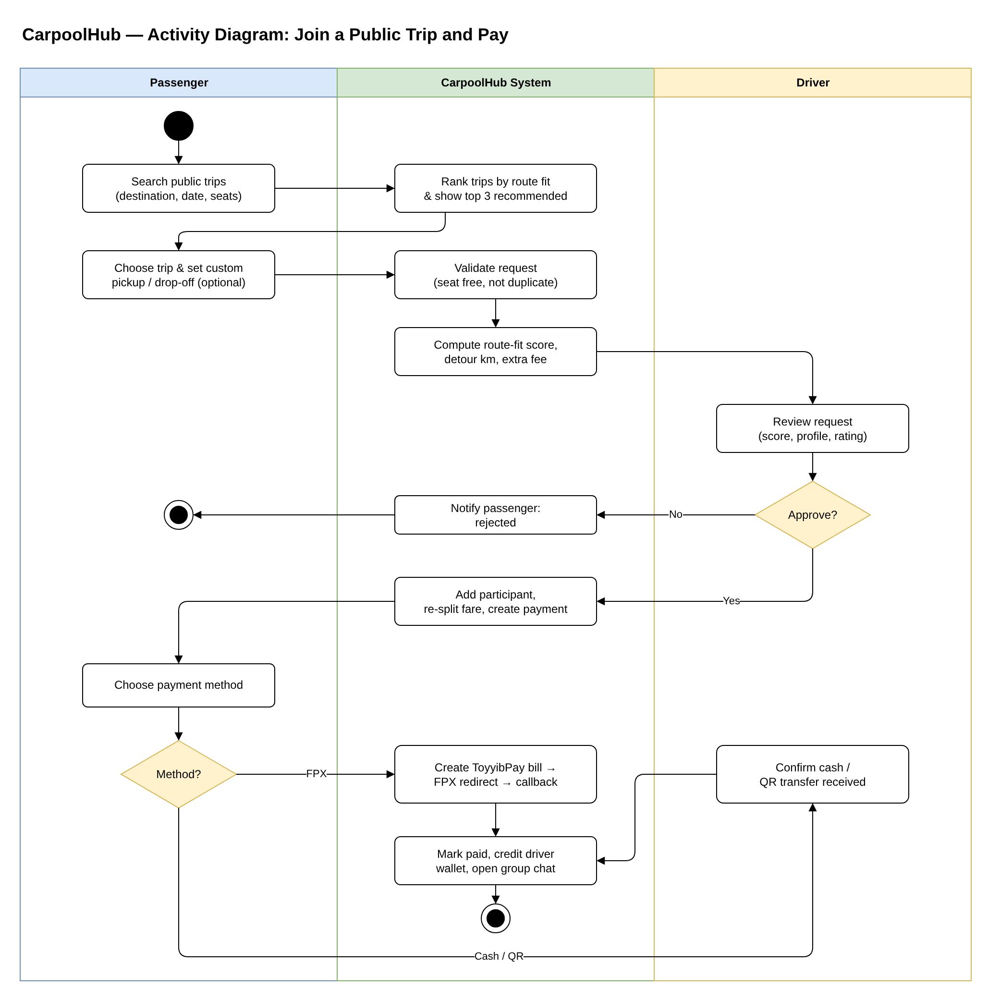

# CarpoolHub — AI-Assisted Ride-Sharing Platform

> **Portfolio showcase.** This repository documents the design and features of my Final Year Project.
> The source code is kept private; a live walkthrough or code review is available on request.

🌐 **Live:** [carpoolhub.prsdntworldwide.com](https://carpoolhub.prsdntworldwide.com) (installable PWA, best on a phone)  
**Final Year Project · Bachelor of Computer Science (Software Engineering), UMPSA**  
**Thesis title:** *CarpoolHub: An AI-Assisted Ride-Sharing System with Custom Route Preference*  
**Role:** Sole developer (analysis, design, development and testing) · **Period:** March 2026 – present

---

## The problem

Students and commuters in Malaysia often share rides informally through WhatsApp groups. Finding a ride on your route, agreeing on a fair price and collecting payment is manual and messy. CarpoolHub puts the whole flow in one installable web app: drivers publish trips, passengers request seats (with their own pickup and drop-off points), fares are split automatically, and payments are tracked to the last sen.

## Key features

| Area | What it does |
|---|---|
| **Trips** | Saved routes on a map (Leaflet + OSRM), one-way / two-way trips, private trips for connections or public trips with a seat limit |
| **Custom route preference** | Passengers can request a custom pickup / drop-off; the system scores route fit, detour distance and extra fee |
| **Join requests** | Seat and duplicate checks, driver approve / reject, automatic fare re-split |
| **Payments** | Cash, QR transfer or **FPX online banking via ToyyibPay**; driver wallet, withdrawal requests and admin approval |
| **Real-time** | Trip group chat over **Ably**, Web Push notifications and Telegram alerts |
| **Trust** | Google sign-in, driver verification, driver ratings, suspension and audit logs |
| **Admin** | User management, withdrawal approval, reports export, system settings |

### AI features (Claude Haiku 4.5 + rule-based scoring)

1. **Bilingual assistant (BM / EN)** — answers questions and can navigate the user to the right page, using the user's saved routes and connections as context. Daily per-user and global usage limits are logged.
2. **Fare advisor** — suggests a fair price and seat count for a trip.
3. **Route recommender** — ranks public trips by how well they fit the passenger's route and highlights the top 3.

Rule-based services (passenger reliability scoring, feature engineering) run alongside the LLM features.

## Screenshots

  
  
  

Home dashboard · 5-step trip wizard · payment confirmation (demo account, mobile view)

## System design

All diagrams are drawn in draw.io. The editable `.drawio` source sits next to each image in [`docs/diagrams`](docs/diagrams).

### Architecture

### Use case diagram

### Entity relationship diagram (core tables)

### Activity diagram — join a public trip and pay

## Engineering highlights

- **Service layer** keeps controllers thin (`TripService`, `PaymentService`, `WalletService`, `ChatService`…), so business rules live in one place.
- **Payment safety:** every ToyyibPay bill is stored as a `gateway_transaction` with the raw callback, and a reconcile command re-checks pending payments with the gateway.
- **Wallet ledger:** each wallet movement records `balance_after`, so balances can be audited.
- **Chat privacy:** trip conversations have a scheduled purge date after the trip ends.
- **Cost control for AI:** every LLM call is logged with model and token counts (`ai_usage_logs`) and limited per user per day.
- **Performance:** composite indexes on the busiest trip and notification queries.

## Tech stack

| Layer | Technology |
|---|---|
| Backend | Laravel 12, PHP 8.2, MySQL, queues & scheduler |
| Frontend | Blade, JavaScript, Tailwind CSS, Vite, installable PWA (service worker) |
| Maps | Leaflet, OpenStreetMap, OSRM routing, Nominatim geocoding |
| Integrations | Anthropic API (Claude Haiku 4.5), ToyyibPay (FPX), Ably, Web Push (VAPID), Telegram Bot API, Google OAuth (Socialite) |
| Tooling | Git & GitHub (300+ commits), PHPUnit, Laravel Pint |

## How I used AI tools while building this

I used AI coding assistants (mainly Claude Code) the way a developer uses a senior pair-programmer: to scaffold boilerplate, suggest refactors, explain errors and draft test cases. The requirements, database design, architecture and feature decisions are my own work for my FYP, and I reviewed, ran and tested every change before committing it.

This is separate from the **AI features inside CarpoolHub** (assistant, fare advisor, route recommender), which I designed and integrated through the Anthropic API as part of the product.

## Contact

**Muhammad Akmal bin Mohd Rashid** — Software Engineering student, UMPSA  
Open to a 6-month internship (22 February – 7 August 2027).  
📧 work.akmalrashd@gmail.com · 💼 [linkedin.com/in/akmalrashd](https://www.linkedin.com/in/akmalrashd)

© 2026 Muhammad Akmal bin Mohd Rashid. Shared for portfolio viewing only; all rights reserved.
